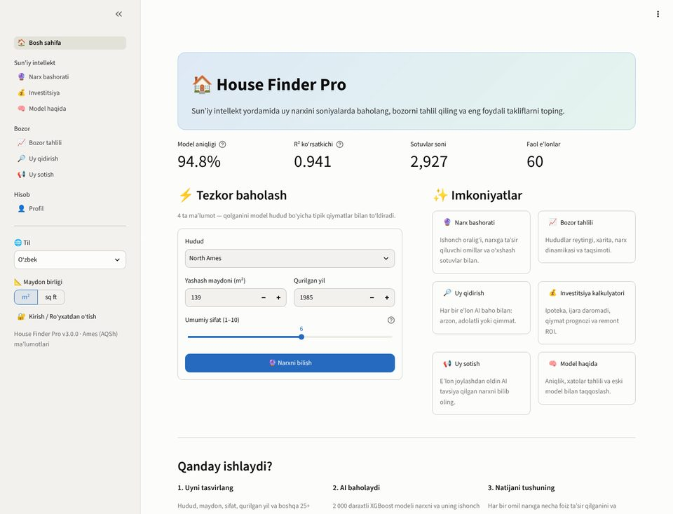
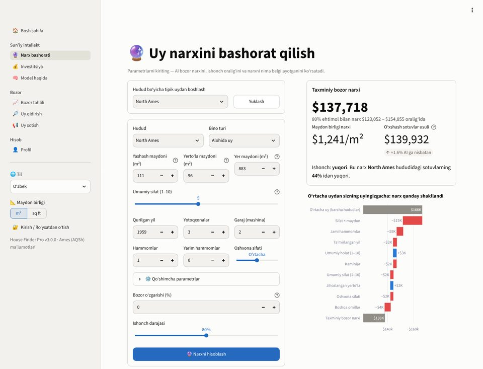
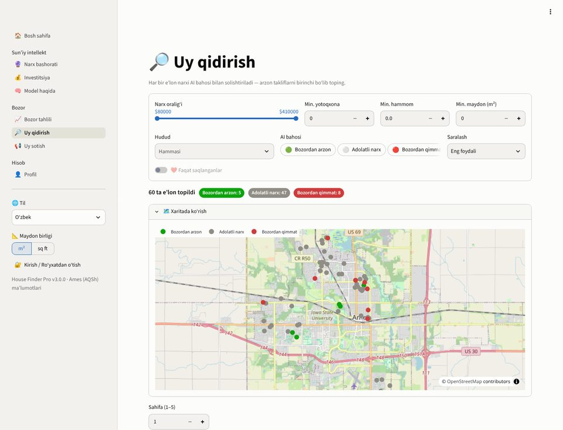

# 🏠 House Finder Pro 3.0 — AI asosidagi ko‘chmas mulk baholash platformasi

Streamlit ilovasi: uy narxini sun’iy intellekt bilan bashorat qiladi, narxni nima belgilayotganini tushuntiradi,
bozorni tahlil qiladi va e’lonlardagi arzon/qimmat takliflarni avtomatik aniqlaydi.
Interfeys **o‘zbek**, **ingliz** va **rus** tillarida.



## Imkoniyatlar

| Sahifa | Nima qiladi |
|---|---|
| 🔮 **Narx bashorati** | 32 belgili XGBoost modeli: narx + 50/80/90% ishonch oralig‘i, har bir omilning narxga ta’siri (SHAP «waterfall»), 6 ta eng o‘xshash real sotuv va ular asosidagi mustaqil baho, hudud bilan solishtirish, JSON/CSV hisobot |
| 📈 **Bozor tahlili** | Hududlar reytingi, xarita, choraklik narx dinamikasi, taqsimot, sifat va maydon ta’siri, hudud profili |
| 🔎 **Uy qidirish** | Filtrlar, xarita, har bir e’lon AI bahosi bilan: 🟢 bozordan arzon · ⚪ adolatli · 🔴 qimmat; saqlash va qiziqish bildirish |
| 📢 **Uy sotish** | E’lon joylashdan oldin AI adolatli narx va narx strategiyasi; rasm yuklash |
| 💰 **Investitsiya** | Ipoteka (amortizatsiya), ijara daromadi (cap rate, cash-on-cash), qiymat ssenariylari, **AI asosidagi remont ROI** |
| 🧠 **Model haqida** | Aniqlik, bashorat vs real narx, xatolar taqsimoti, muhim omillar, eski model bilan solishtirish |
| 👤 **Profil** | Ro‘yxatdan o‘tish/kirish, mening e’lonlarim (uzaytirish, o‘chirish), saqlanganlar |



## Model aniqligi

Model hech qachon ko‘rmagan **440 ta** real sotuvda tekshirilgan:

| Ko‘rsatkich | Eski model (v2, 6 belgi) | **Yangi model (v3, 32 belgi)** |
|---|---|---|
| R² | 0.881 | **0.941** |
| O‘rtacha xato (MAE) | $19,232 | **$12,958** (−33%) |
| O‘rtacha % xato (MAPE) | 10.98% | **7.53%** |
| 80% ishonch oralig‘i qamrovi | — | **79.3%** (to‘g‘ri kalibrlangan) |

Texnik tafsilotlar:

- **Maqsad** — `log(narx)`: xatolar narxga proporsional, omillar ta’siri foizda o‘qiladi.
- **Kategoriyalar** (hudud, bino turi, …) XGBoost’da to‘g‘ridan-to‘g‘ri ishlatiladi; qo‘shimcha belgilar: umumiy maydon, jami hammomlar, sifat × maydon.
- **Monoton cheklovlar** — maydon, sifat, hammom, garaj va boshqa yaxshilanishlar narxni hech qachon tushirmaydi. Bu remont tahlilini ishonchli qiladi (testlar bilan tekshiriladi).
- **Ishonch oralig‘i** — konformal usul: 5 qismli kross-validatsiya qoldiqlarining kvantillari.
- **Tushuntirish** — har bir bashorat uchun SHAP qiymatlari (`pred_contribs`).
- **Versiya himoyasi** — saqlangan model yuklanganda nazorat bashoratlari tekshiriladi; XGBoost versiyasi mos kelmasa, model avtomatik qayta o‘qitiladi (~10 s).



## Ishga tushirish

```bash
git clone https://github.com/Axadxon01/house-finder-2.0.git
cd house-finder-2.0
pip install -r requirements.txt
streamlit run app.py
```

Brauzerda `http://localhost:8501` ochiladi. Birinchi ishga tushirishda 60 ta namuna e’lon yaratiladi
(model o‘qitishda ko‘rmagan real Ames sotuvlari).

### Streamlit Community Cloud’ga joylash

1. [share.streamlit.io](https://share.streamlit.io) → **Create app** → GitHub repozitoriy `Axadxon01/house-finder-2.0`.
2. Branch: `main`, Main file path: `app.py`.
3. **Deploy** — tayyor. (Streamlit Cloud’da fayl tizimi vaqtinchalik: ilova qayta ishga tushganda foydalanuvchilar va e’lonlar bazasi tozalanadi. Doimiy saqlash uchun tashqi ma’lumotlar bazasi ulang.)

### Modelni qayta o‘qitish

```bash
python train.py   # models/price_model.ubj va models/metadata.json ni yangilaydi
```

### Testlar

```bash
pip install pytest
pytest            # 42 ta test: model, moliya, auth, baza, tarjimalar, barcha sahifalar 3 tilda
```

## Loyiha tuzilmasi

```
app.py                  # kirish nuqtasi: navigatsiya, til, maydon birligi
views/                  # sahifalar: home, predict, market, search, sell, invest, insights, account
housefinder/
  features.py           # belgilar sxemasi, feature engineering, monoton cheklovlar
  model.py              # o‘qitish, baholash, ishonch oralig‘i, SHAP, o‘xshash sotuvlar
  data.py               # Ames ma’lumotlarini yuklash va tozalash
  db.py                 # SQLite: foydalanuvchilar, e’lonlar, saqlanganlar, qiziqishlar
  auth.py               # PBKDF2-SHA256 (tuz bilan) parol xeshlash
  finance.py            # ipoteka, ijara, prognoz, ROI
  i18n.py               # o‘zbek / ingliz / rus tarjimalari
  ui.py                 # umumiy UI yordamchilari va uy formasi
train.py                # modelni o‘qitish skripti
models/                 # o‘qitilgan model + metama’lumot
data/AmesHousing.csv    # ma’lumotlar to‘plami
tests/                  # pytest testlari
legacy/                 # v2 versiyaning eski fayllari (ma’lumot uchun)
```

## Cheklovlar

- Ma’lumotlar — **Ames (Ayova, AQSh), 2006–2010** yillardagi 2 927 ta sotuv; narxlar AQSh dollarida.
  Bugungi bozor uchun «Bozor o‘zgarishi (%)» sozlamasidan foydalaning yoki o‘z hududingiz ma’lumotlarida modelni qayta o‘qiting.
- Xaritadagi hudud markazlari taxminiy.

---

### English summary

House Finder Pro 3.0 is a multilingual (Uzbek/English/Russian) Streamlit app for AI real-estate valuation:
an XGBoost price model with calibrated conformal intervals, per-prediction SHAP explanations, comparable sales,
market analytics, a deal-scoring listing search, seller pricing guidance, and an investment calculator with
model-based renovation ROI. Held-out R² 0.941, MAE $12,958 (−33% vs. v2). Run with `streamlit run app.py`.
